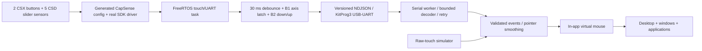

# Architecture

The task scans and processes all widgets using `Cy_CapSense_ScanAllWidgets`, `Cy_CapSense_IsBusy`, and `Cy_CapSense_ProcessAllWidgets`. It reads button state with `Cy_CapSense_IsWidgetActive` and slider centroid with `Cy_CapSense_GetTouchInfo`. All IDs and resolution come from generated structures. A 10 ms periodic task owns sensing, gestures, and UART, avoiding concurrent writes and event queue overflow. Movement is limited to 50 Hz and changes only; state/heartbeat is sent at 2 Hz. Interrupt priority 5 and the existing FreeRTOS configuration are retained. Scan timeout is 100 ms; UART writes have a 50 ms deadline. Fatal initialization/scan/RTOS failures halt the MCU; the PC detects missing messages rather than continuing a stuck drag. UART partial failures increment a transmitted error counter; malformed partial lines are rejected and framing recovers at a newline.

The UART worker runs outside the Qt UI thread. It reads at most 512 bytes per poll, limits line storage to 256 bytes, discards oversized frames through the next newline, validates schemas, tracks sequence continuity, and retries on failure. Selecting a different port discards buffered data and sequence state. Qt signals transfer events to the UI thread. Disconnect, restart, or sequence gaps cancel held pointer actions. STATUS reconciles a lost left release without synthesizing a new press.

The touch engine maps normalized slider input across 0–(extent−1), changing only the selected axis. A persistent firmware mode latch toggles on the B1 rising edge. MODE, MOVE and STATUS synchronize the axis; BUTTON reports both physical button states. B2 down/up maps to left down/up. STATUS uses B2 to recover a lost release. HELLO/STATUS must advertise `controls:"toggle-b1-click-b2"` before the worker forwards input, preventing silent use of legacy firmware.

An axis change freezes the previous target. The next sample anchors the new axis at the current pointer, with a monotonic piecewise mapping that preserves both endpoints. A switch at an endpoint uses pickup. See TOUCH_MAPPING.md for formulas and edge cases. Window resizing scales both current and target coordinates by their normalized fractions. Smoothing uses `1-exp(-dt/tau)` with configurable tau (default 45 ms); a configurable maximum speed limits large changes. Sensitivity changes a monotonic response curve while retaining endpoints. Slider release freezes movement at the current rendered point.

A transparent pointer overlay draws a fading trail, axis label and click ring. Synthetic Qt mouse events target the child widget underneath; a pressed widget retains the drag until release. Touch hover styling follows the hit-tested widget. Title bars and resize grips use the event's screen coordinates. All input is confined to this application's widget tree. There is no global OS input injection.

Window instances and taskbar entries are owned by AppManager. Closing destroys the window; minimizing hides it, and taskbar selection restores/focuses it. Maximize tracks the available canvas and restore clamps the old geometry after dashboard resizing. Windows fade in over 180 ms; the mode badge animates over 280 ms. Notes persists user text in the OS per-user app-data directory. Settings persists pointer configuration and theme in the same directory. File Explorer uses an interactive mock tree with sample file contents. Calculator parses a restricted arithmetic AST, never `eval`. The event log holds at most 80 blocks, pointer trail holds at most 32 points, and event-rate history holds at most 1,000 timestamps. Telemetry is refreshed at 10 Hz while pointer rendering targets a 16 ms frame interval.

Build inputs are independent copies of the existing BSP, SDK, CapSense middleware, and supported FreeRTOS configuration. SDK/middleware licenses are retained alongside their source. Other project directories are read for provenance only and are not build inputs.
