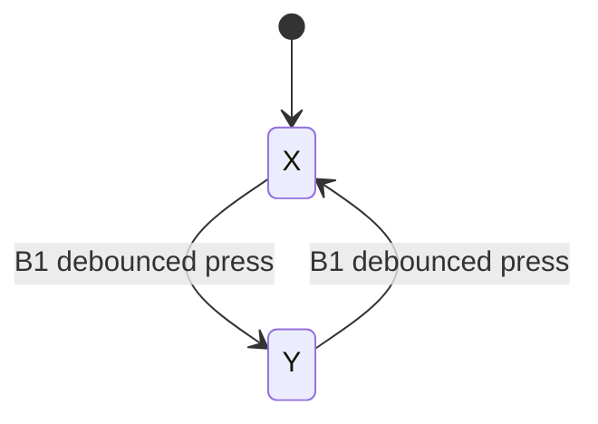

# Touch controls and mapping

Physical **Button 1** is generated widget `CY_CAPSENSE_BUTTON0_WDGT_ID`. Physical **Button 2** is `CY_CAPSENSE_BUTTON1_WDGT_ID`. Slider `CY_CAPSENSE_LINEARSLIDER0_WDGT_ID` has five CSD sensors. The SDK centroid is normalized by the generated widget's actual `xResolution`, yielding 0–100. Pins, thresholds, clocks, CapSense files and FreeRTOS configuration are preserved.

## Deterministic firmware states

Each button must remain at its raw candidate value for **30 ms** before its debounced state changes. Unsigned elapsed-time subtraction tolerates tick wrap. B1's debounced rising edge flips a persistent X/Y latch. A short press is sufficient; holding does not repeat, and release retains the axis. B2's rising/falling edges emit left down/up. There is no axis hold threshold and no physical right-click assignment. Launch exposes the application/context actions through the same left pointer.

B1 release does not change either state. B2 has an independent up/down state: B2 down + slider motion is a drag. B1 can change the axis while B2 remains held, permitting a continuous drag in both axes sequentially.

Sample priorities: debounce both buttons; toggle and emit MODE; emit BUTTON1 then BUTTON2 edges; emit B2 LEFT_CLICK edge; process slider MOVE/RELEASE. A down precedes same-sample movement. Lifting the slider freezes motion but retains B2 until its physical release. Disconnect/restart/sequence loss cancels a held control without clicking it. STATUS reconciles lost up/release/mode events.

## Normalized range and sensitivity

Without an axis anchor, normalized slider input `p = position/100` maps to `p*(extent−1)` along the selected axis. Endpoints reach the complete dashboard width/height, including taskbar and connection controls. A five-position sweep at 0,25,50,75,100 spans the range; the hardware remains a continuous one-dimensional slider. The inactive pointer axis stays fixed.

Sensitivity uses a monotonic curve:

`q = 0.5 + sign(p−0.5) * 0.5 * (2*abs(p−0.5))^(1/sensitivity)`

Both endpoints remain 0 and 1 at every sensitivity. Default sensitivity is 1 (linear). A configurable endpoint snap zone, default 1%, maps near-end readings to the exact edges. A 0.4% input deadband rejects small repeated jitter. Firmware positions are integers, so adjacent whole-percent changes remain accepted.

## Avoiding mode-switch jumps

A MODE change first freezes both targets at the rendered pointer. The first MOVE in the new axis establishes anchor `(a,c)`, where `a` is curved normalized slider input and `c` is the current normalized pointer coordinate. That first sample does not move the pointer. For an interior anchor:

| Slider input | New normalized coordinate |
|---|---|
| `q <= a` | `(q/a)*c` |
| `q > a` | `c + ((q−a)/(1−a))*(1−c)` |

This preserves the switch point and both full-range endpoints. Positions between endpoints can be nonlinear after anchoring, even with sensitivity 1. The anchor persists through slider lift until another mode switch or reconnect.

If the first sample is at an endpoint different from the pointer coordinate, an interior anchor is impossible. The HUD shows **PICKUP** until the slider crosses the current normalized pointer coordinate. Then absolute control resumes. This avoids jumping to the endpoint on the switch while keeping both edges reachable. Startup reconnect also anchors the first movement; STATUS alone does not move the pointer.

## Smoothing, speed and resizing

The engine uses `alpha = 1-exp(-dt/tau)` (default tau=45 ms; zero disables smoothing) and a maximum speed (default 3 screen widths/heights per second). Settings ranges: speed 0.25–8 screens/s, smoothing 0–250 ms, sensitivity 0.3–3, edge snap 0–5%. Targets and output coordinates are clamped. Smoothing and rate limits prevent sudden large sample changes from teleporting the rendered pointer.

On window resize, current and target X/Y coordinates scale by their previous normalized fractions; anchors are already normalized. Window bounds remain enforced. Slider release freezes the current rendered point, and B2 up releases the drag target. Settings and accent theme save to the per-user `pointer-settings.json` beside Notes data.
