# Architecture and scheduling

```mermaid
flowchart LR
    E[2 buttons + 5 slider electrodes] --> C[CapSense CSD scan / ISR]
    C --> A[Acquisition task: raw + baseline]
    A -->|raw queue 8| P[Preprocess: normalize + pre-roll + window]
    P -->|window queue 2| I[MCU INT8 temporal CNN / TFLM]
    I -->|result queue 4| D[Dispatch: rejection + RGB + event]
    P --> T[UART TX queue 12]
    D --> T
    T --> U[UART task: framed CRC protocol]
    U --> H[PySide6 studio]
    H --> R[Labelled physical session NPZ]
    R --> M[Grouped train / evaluation / INT8 export]
    M --> F[Model C array compiled into firmware]
    F --> I
    H -->|parity command queue 2| I
```

|Task|Priority|Stack words / bytes|Ownership|
|---|---:|---:|---|
|Acquisition|5|768 / 3072|CapSense, 20 ms requested scan period|
|Preprocess|4|1536 / 6144|Normalization, segmentation, sample telemetry|
|Inference|2|2048 / 8192|TFLM, arena, sequential parity and gesture invocation|
|Dispatch|3|768 / 3072|LED and prediction event serialization|
|UART|3|1024 / 4096|Only owner of serial HAL and framing state|

Stacks total 24,576 bytes for application tasks, allocated from the 49,152-byte FreeRTOS heap_4 region. Idle/timer stacks, TCBs and bounded queues also use that region. A 24,576-byte aligned static tensor arena is separate from the RTOS heap. Linker `.bss` includes the entire RTOS heap and arena, so the static RAM total is not the actual heap high-water usage. Telemetry reports each task's remaining stack words and actual arena used after AllocateTensors; neither has been measured on hardware.

A CapSense interrupt drives completion in the middleware. The acquisition task polls IsBusy with a one-tick sleep and a 100 ms timeout. It processes widgets only after completion; other tasks never touch CapSense context. Queue overflow increments a shared drop counter and does not block acquisition. Preprocessing discards partial windows on timestamp gaps >40 ms. A task liveness check reports a fault by halting if a previously active pipeline task stalls >500 ms. Fault/malloc/stack hooks halt; reset/recovery needs the operator. There is no autonomous watchdog recovery.

RGB writes occur at predictions, not at sensor scan frequency. Active-low red means rejected/unknown, green means an accepted prediction =90%, blue means accepted below 90%. LEDs remain off until a result. High confidence alone does not bypass the synthetic-model guard, margin, truncation or unknown rejection.

TFLM schema/type/shape checks and AllocateTensors run before inference. Init failure halts with fault code 20. The operator resolver contains only Conv2D, AveragePool2D, Reshape, FullyConnected and Softmax. The library embeds CMSIS-NN; inspect link map symbols for the kernels actually linked. DWT cycle timing surrounds Invoke including quantization/dequantization, not acquisition or the segmentation wait. DWT wraps after ~35.8 s at 120 MHz; normal inference is expected far shorter, but hardware timing is unverified.

UART RX uses a 1024-byte HAL/PDL interrupt-backed software ring, independently of the bounded framing buffer. This absorbs a parity command while TX is busy; actual sustained behavior still requires hardware testing.

The stock BSP linker reserves the remaining CM4 SRAM as a NOLOAD C heap. Thus its RAM region percentage includes a large unused reservation. `__HEAP_SIZE` is not a supported control in that stock script; ChordSlide does not pretend it sizes that region. Consult the section report and RTOS/arena watermarks separately.
