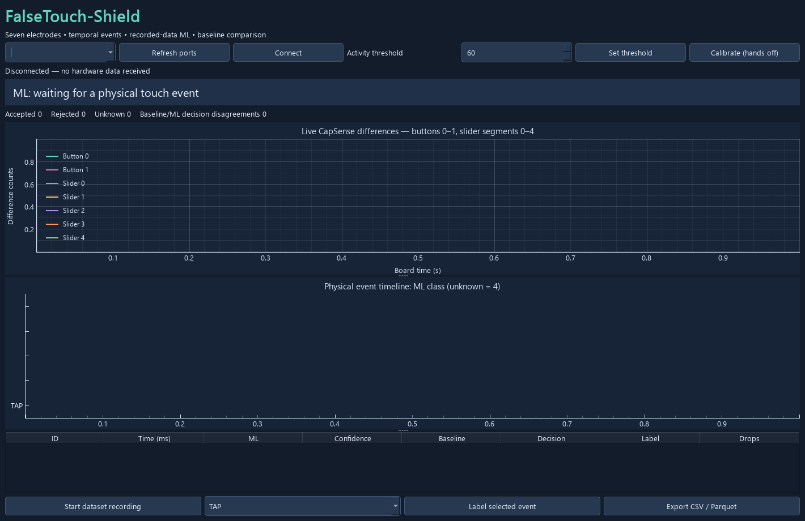

# FalseTouch-Shield

**Seven-channel touch analysis, dataset collection and deployable-model tooling for the Infineon CYW9P62S1-43438EVB-01.**

> **Live dataset collection is pending.** Real board touch recordings still need to be collected and labelled before training, evaluating and deploying the ML classifier. The supplied production firmware returns **UNKNOWN (confidence 0)** for ML. A separate, clearly labelled synthetic smoke model tests the training/export pipeline; its results are **not real touch accuracy**.

## Overview

The project uses only the board's two CapSense buttons, five-segment slider, RGB LED and KitProg3 USB-UART. FreeRTOS firmware acquires seven processed sensor differences, segments events, extracts six temporal features, computes a conventional baseline, and communicates with a Windows dashboard through a framed CRC-protected protocol. No external hardware is required.

| Component | Included behavior |
|---|---|
| Firmware | CapSense calibration, bounded event processing, safe RTOS queues, watchdog/heartbeat checks and RGB feedback |
| Classification | TAP, HOLD, GRAZE and WIDE baseline; portable learned-tree inference interface; explicit untrained abstention |
| Dashboard | Seven waveforms, event timeline, ML confidence, counters, baseline comparison, recording/labelling and CSV/Parquet export |
| UART | Framing, message types, sequence numbers, CRC16 and command acknowledgements |
| ML tooling | Physical-data collector, shared feature definitions, session-grouped training/evaluation, confusion matrix generation and C export |
| Validation | Host protocol tests, C/Python feature parity, synthetic learned-model parity and UART MCU parity tooling |



*Recorded offline preview. Empty plots are intentional; live board data has not yet been collected.*

## Verification status

| Check | Recorded result |
|---|---|
| Firmware compilation/linking | Verified with ModusToolbox 3.9 and Arm GCC 14.2.1 |
| Reproducible firmware | Two clean builds produced identical HEX files |
| Firmware flash use | 53,016 / 1,048,576 bytes |
| Host automated tests | 16 passed |
| Synthetic model parity | Native C/Python agreement on 1,129 vectors |
| Windows executable | Built and launched independently in an offline smoke check |
| Live dataset and real ML accuracy | **Pending; no real dataset or physical accuracy result** |
| Actual MCU inference parity | **Not verified** |
| Board programming/physical interaction | **Not performed for this project** |

See [VERIFICATION_REPORT.md](VERIFICATION_REPORT.md) for scope, warnings and the repository publication checks. Existing successful CapSlide hardware sessions do not establish hardware validation for FalseTouch-Shield.

## Download and run

1. Download [FalseTouch-Shield-Windows-x64.zip](prebuilt/FalseTouch-Shield-Windows-x64.zip) using GitHub's **Download raw file** action.
2. Extract the entire archive. Keep `FalseTouch-Shield.exe` with its `_internal` directory.
3. Run the EXE. The packaged app does not need an installed Python interpreter.
4. After separately programming compatible firmware, select the primary KitProg3 COM port and connect at **115200 8N1**, no flow control.

The application remains disconnected until actual UART communication occurs. It does not simulate a board, successful touch interaction or sensor data. Flashing is a separate user action; see [FLASH_GUIDE.md](FLASH_GUIDE.md).

Recorded [HEX](prebuilt/firmware/FalseTouch-Shield.hex), [ELF](prebuilt/firmware/FalseTouch-Shield.elf), [BIN](prebuilt/firmware/FalseTouch-Shield.bin) and [MAP](prebuilt/firmware/FalseTouch-Shield.map) are included. Prefer HEX for programming because it preserves addresses. See [prebuilt/README.md](prebuilt/README.md) for checksums and limitations.

## Setup from source

```powershell
git clone https://github.com/PRIY4DH4RS4N-D/CYW9P62S1-PSoC-Firmware-Lab.git
cd CYW9P62S1-PSoC-Firmware-Lab\FalseTouch-Shield
powershell -ExecutionPolicy Bypass -File scripts\setup.ps1
.\.venv\Scripts\python -m dashboard.app
```

Use Python 3.11 x64. The setup installs `requirements.txt`; [requirements-verified.txt](requirements-verified.txt) records the direct package versions used in the verified development environment. Native C tests also require `gcc` in PATH, such as `C:\MinGW\bin\gcc.exe`.

### Build firmware

```powershell
powershell -ExecutionPolicy Bypass -File scripts\build_firmware.ps1 -Clean
```

The default tool paths are `C:\Infineon\Tools\ModusToolbox\tools_3.9` and `C:\Infineon\Tools\mtb-gcc-arm-eabi\14.2.1\gcc`. Override the script's `-Tools` and `-Compiler` parameters for other installations. The target is `APP_CYW9P62S1-43438EVB-01`, MCU `CY8C6247BZI-D54`, with the CM4 application and BSP CM0+ sleep image linked together.

The versioned SDK is included in this project's `sdk/` directory. Firmware builds do not depend on a neighbouring workspace project or `C:\Psoc_Projects\mtb_shared`. CapSense 2.0 and FreeRTOS 10.4.302 source are in `firmware/vendor/`, with their original licenses retained. Optional `scripts/dependencies.ps1` restores/refreshes SDK assets from the pinned middleware manifests. Normal builds use the included local files.

Build outputs are generated under ignored `build/` and `firmware/build/` directories. The build script copies current ELF/HEX/BIN/MAP files into `build/artifacts/` and never flashes hardware.

### Run software checks

```powershell
powershell -ExecutionPolicy Bypass -File scripts\test.ps1
```

This runs the host tests, explicitly synthetic training smoke test and native C model parity. It does not establish physical accuracy or Cortex-M4 parity.

### Package Windows

```powershell
powershell -ExecutionPolicy Bypass -File scripts\package.ps1
```

Output: `build/dist/FalseTouch-Shield/FalseTouch-Shield.exe`. Distribute the whole adjacent folder. Offline launch check:

```powershell
.\build\dist\FalseTouch-Shield\FalseTouch-Shield.exe --self-test build\dashboard-exe-smoke.json
```

This generates an offline status JSON and screenshot, then exits without connecting to hardware.

## Collect live data, then train and deploy

**This work is still pending.** The intended workflow is:

1. Program the untrained collection firmware when you choose to do so, and verify all seven physical channels.
2. Record independent sessions with deliberate TAP/HOLD and incidental GRAZE/WIDE interactions. Label events from their physical meaning, independently of the baseline prediction.
3. Exclude sessions with resets, drops or sequence gaps. Include every class, multiple electrode positions, people and conditions.
4. Train and evaluate using whole-session holdout splits. Review the confusion matrix and false acceptances before installing a model.
5. Export/install the learned C model, rebuild, separately program it, and run real UART MCU parity and physical acceptance checks.

Dashboard recording is available, or use the console collector:

```powershell
.\.venv\Scripts\python -m ml.collect --port COM7 --output ml\session-01.jsonl
.\.venv\Scripts\python -m ml.train ml\session-01.jsonl ml\session-02.jsonl ml\session-03.jsonl --output ml\artifacts
.\.venv\Scripts\python -m ml.parity ml\artifacts
```

Use your actual COM port. At least three independent sessions are required, and each split must contain every class. Training uses float32 features and a depth-limited decision tree, with class weighting and minimum leaf size. It produces held-out metrics, baseline comparison, a confusion matrix PNG, portable `model.h`, tree structure and parity vectors.

Only after reviewing recorded-data results, repeat training with `--install` to replace `firmware/model.h`, then rebuild. Programming is separate. After programming matching trained firmware, test actual embedded inference with:

```powershell
.\.venv\Scripts\python -m ml.parity ml\artifacts --port COM7
```

Synthetic-only pipeline checks remain separate:

```powershell
.\.venv\Scripts\python -m ml.smoke
.\.venv\Scripts\python -m ml.parity ml\synthetic_smoke
```

**Do not use synthetic smoke accuracy as evidence of real touch performance.** See [data collection](docs/DATA_COLLECTION.md) and [ML evaluation status](ml/EVALUATION.md).

## Project tree

```text
FalseTouch-Shield/
|-- firmware/                  Application C, generated BSP and vendor middleware
|-- sdk/                       Independent versioned SDK dependencies
|-- dashboard/                 Desktop UI and serial worker
|-- ml/                        Collection, features, training, evaluation and export
|   |-- synthetic_smoke/       Explicitly artificial pipeline-test artifacts
|-- protocol/                  Shared Python codec and UART specification
|-- tests/                     Host protocol, C parity, training and UI checks
|-- scripts/                   Setup, dependency refresh, builds and tests
|-- docs/                      Architecture, hardware research and collection guide
|-- prebuilt/                  Windows ZIP, firmware and preserved verification
|-- requirements.txt
|-- requirements-verified.txt
|-- FLASH_GUIDE.md
|-- VERIFICATION_REPORT.md
```

## Firmware policy and documentation

Events start when a channel crosses the activity threshold and finish after three quiet scans or a five-second window. The baseline uses duration, peak and electrode width heuristics; these are starting thresholds, not calibrated accuracy claims. TAP/HOLD are accepted and GRAZE/WIDE rejected; untrained ML is UNKNOWN, neither accepted nor rejected. RGB reports green/red/blue respectively after an event. Hardware timing, sensitivity, watchdog recovery and LED behavior still require board validation.

- [Architecture](docs/ARCHITECTURE.md)
- [Hardware and API research](docs/HARDWARE_RESEARCH.md)
- [UART protocol](protocol/PROTOCOL.md)
- [Flash guide](FLASH_GUIDE.md)
- [Verification report](VERIFICATION_REPORT.md)
- [License](LICENSE) and [third-party notices](NOTICE.md)

## Git LFS download note

The Windows ZIP is stored with Git LFS. GitHub's **Download raw file** action retrieves the actual ZIP. If a clone contains a small text pointer instead of the archive, install Git LFS and run from the repository root:

```powershell
git lfs install
git lfs pull --include="FalseTouch-Shield/prebuilt/FalseTouch-Shield-Windows-x64.zip"
```

Source firmware and SDK files use normal Git storage. The [SHA256 checksums](prebuilt/SHA256SUMS.txt) identify the complete ZIP, not its pointer.
