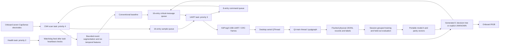

# Architecture

RTOS queues copy whole messages; no queued pointer references stack memory. CapSense interrupt priority 5 dispatches only the middleware handler. Scan task stack: 1024 words; UART: 1024; health: 384. FreeRTOS heap_4 reserves 49152 bytes and is used at startup; application tasks do not dynamically allocate after initialization. Allocation failures and stack overflow hooks halt, allowing watchdog recovery once started. Tickless idle is explicitly disabled to keep timing and avoid inheriting unsupported sleep hooks. Deep sleep and Wi-Fi/Bluetooth are unused.

Sampling cadence is nominally 10 ms. Actual scan completion and scheduling affect it; telemetry includes actual tick timestamps. A slow scan is not fabricated into successful timing. Feature `samples` records the observed frame count; `duration_ms` uses event timestamps plus the nominal frame. No absolute accuracy or latency requirement was supplied, so none is invented or declared met.

Host uses bounded waveform history (800 samples) and a 20 Hz plot refresh. Serial I/O occurs in a QThread; widget updates occur via queued signals on the GUI thread. Full event tables and recorded samples remain in host memory during a session; split long recordings into manageable sessions. JSONL is the training source; CSV/Parquet are user exports. Recording labels bind to session UUID and event ID, including after Stop recording.

Parity levels are deliberately separate: shared protocol and feature C code on a Windows host; generated synthetic tree on a Windows host; actual Cortex-M4 execution through UART. Only the first two can be verified without programming/testing the board.
